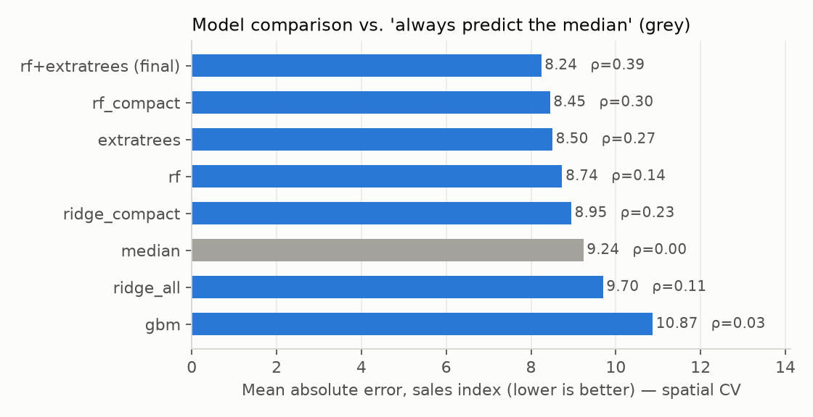
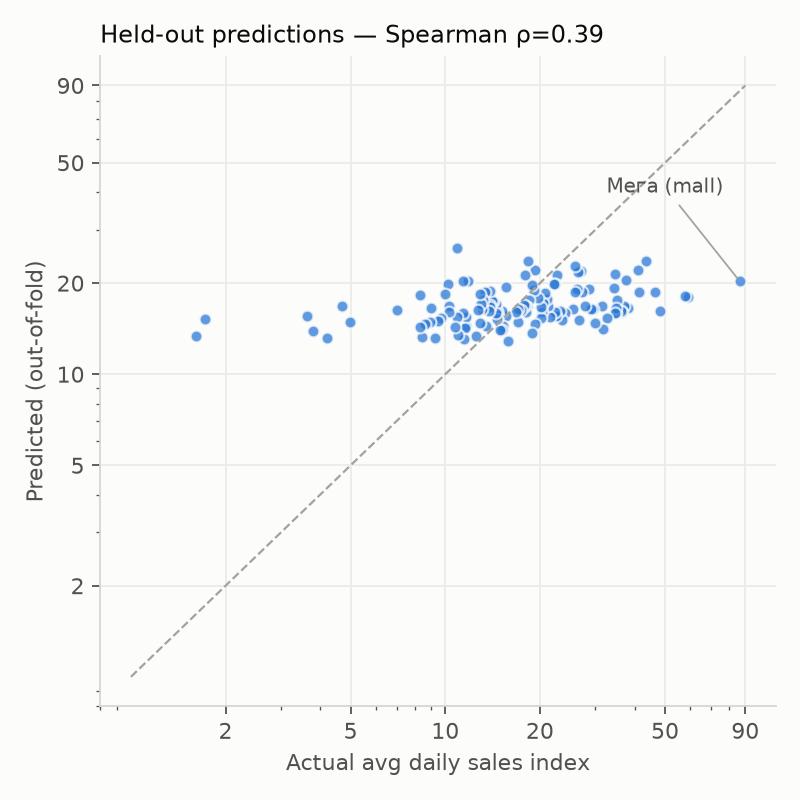
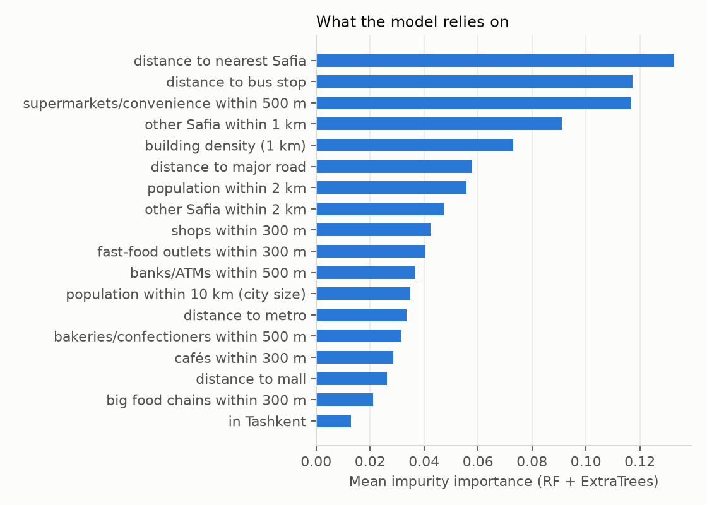
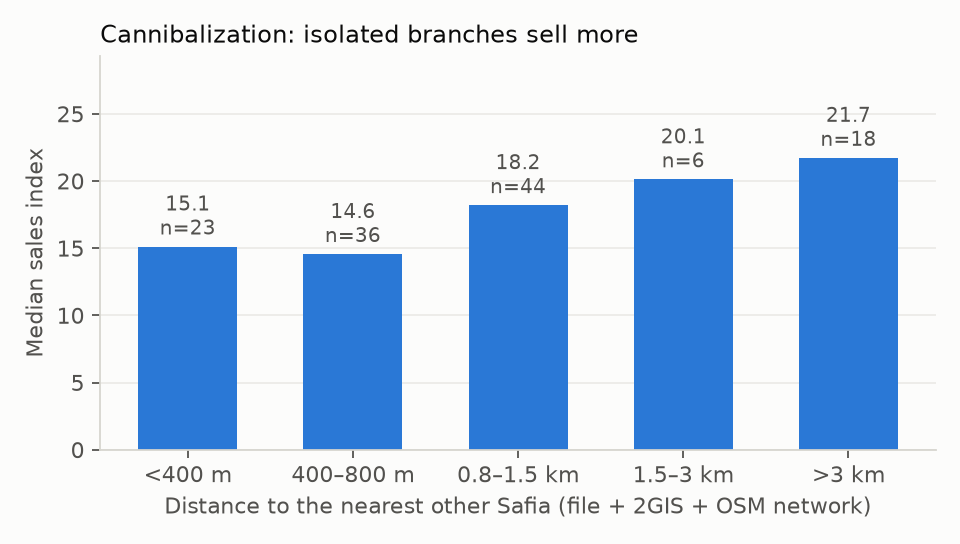

# The Next Safia: research report

**The task:** given a proposed location, predict its expected sales index (1–100) before opening.
**The deliverable:** `src/predict.py` (single location or CSV), `app/app.py` (click on a map) and `reports/map.html`. See the README for how to run them.

---

## 1. Summary

- The model predicts a location's index from its surroundings: nearby businesses, population, transport, and **the rest of the Safia network**. It is validated on *held-out areas* so the score reflects "a branch it has never seen", which is how Safia will test it.
- **Spatial cross-validation:** MAE **8.24** index points against **9.24** for always predicting the network median (−11%). Rank correlation (Spearman ρ) is **0.39**.
- **The strongest factor is cannibalization.** Branches whose nearest other Safia is more than 3 km away have a median of 21.7, against about 15 for those within 800 m. Getting this right meant rebuilding the *full* Safia network (187 locations) from 2GIS and OSM, because the file contains only 127 of the branches.
- **Busy retail areas help**: supermarkets and convenience stores, shops, fast food and banks within 300–500 m, and closeness to bus stops.
- **Honest limitation:** a location explains only part of a branch's sales. The model is better at **ranking** sites than at predicting exact values. Its predictions are pulled towards the middle (roughly 9–27), so it under-predicts stars like Мега (86.5) and over-predicts weak branches. Each prediction comes with a calibrated 80% range and a confidence flag.

## 2. The data

`SampleSales_01-10_Sep_2026.xlsx`: 127 branches with coordinates, plus daily sales and orders indices for 1–10 Sep 2026.

| Observation | Implication |
|---|---|
| Target = 10-day average daily sales index. Skewed: median 17.8, mean 20.4, max 86.5 (Мега, in Mega Planet mall) | Model `log(sales)`, convert back, clip to [1, 100] |
| Daily values are stable (average day-to-day CV per branch 12.5%). The network-wide day pattern is mild (Saturday 5 Sep is highest, the 1 Sep holiday is not unusual) | A 10-day mean is a reliable label for each branch; the 10 days are not a reason for concern |
| Sales correlate with orders at r = 0.93; avg check correlates with sales at ρ = 0.56 | Sales depend on both traffic and basket size. Avg check isn't known before opening, so it can't be an input |
| 102 of 127 branches are in Tashkent; 19 other cities have 1–4 each | Regional predictions are uncertain. The app flags low confidence when the nearest training branch is more than 30 km away |
| Regional branches are **not** weaker on average (mean 22.3 vs 19.9 in Tashkent) | "City size" alone doesn't determine performance; a regional Safia often has little competition |
| The "About" sheet: about 130 branches excluded (missing or wrong location, partial sales) | The hidden test branches probably come from this group. **Network features built only from the file would undercount neighbours**, so the full network was rebuilt (§3) |
| Three pairs share identical coordinates (e.g. Эко/Атлас, Чиланзар/Ало, Чирчик/Чирчик Юсупов) | Probably geocoding duplicates in the source data; worth reporting to the data owner |
| Neighbours' sales don't predict a branch (ρ ≈ 0.06); neither does distance to the Tashkent centre | Sales are driven by very local factors, so kriging or "copy the neighbours" approaches won't work |

## 3. Factors and data sources

All factors are computed by one function, `Featurizer.transform(lat, lon)`, for training and prediction alike, so the two can't drift apart.

| Group | Factors (counts within a radius, or log distance) | Source |
|---|---|---|
| **Safia context** | Distance to the nearest other Safia; number of Safia within 1 km and 2 km | **File + 2GIS (152) + OSM (110)**, deduplicated within 120 m → 187 locations |
| **People & activity** | Population within 2 km and 10 km (city size); building density; supermarkets/convenience, shops, banks, cafés and fast food within 300–500 m | Kontur population H3 grid (400 m), OpenStreetMap (Geofabrik extract) |
| **Competition** | Bakeries, confectioners and competitor brands (Bon!, Бабушки Майи, Дока хлеб, …) within 500 m; large food chains (Evos, Oqtepa, KFC, Max Way, Les Ailes, …) within 300 m | OSM names and brands |
| **Accessibility** | Distance to metro, bus stop, major road and mall | OSM |

How the factors were chosen: about 60 candidate features (`features.py`) were screened by correlation, by sense-checking, and by cross-validation. A compact set of 18 interpretable features beat "all 60", which overfits at n = 127.

**Food chains as evidence of a good site:** Evos, Oqtepa and similar chains do their own site selection, so their presence nearby is a cheap signal of footfall. It ended up a weak factor.

## 4. Validation

**Spatially grouped CV.** Branches are clustered into 12 geographic groups and whole groups are held out (6 folds, repeated with 5 seeds). Random K-fold would be optimistic, because a held-out branch would often have a near-twin in training.

| Model | MAE | Spearman ρ |
|---|---|---|
| Always predict the median (baseline) | 9.24 | — |
| Ridge, compact features | 8.95 | 0.23 |
| Random forest, compact features | 8.45 | 0.30 |
| **RF + ExtraTrees average (final)** | **8.24** | **0.39** |
| Gradient boosting | 10.9 | 0.03 (overfits at n = 127) |

**Uncertainty.** The 80% range comes from the 10th and 90th percentiles of the out-of-fold log residuals, which works out to about ×0.55 to ×2.1 around the prediction. The calibration is based on the same CV residuals, so coverage is nominal. Each result also reports the distance to the nearest training branch: over 30 km gives low confidence, 5–30 km gives medium.

**Explanations.** For each prediction, every factor is replaced in turn by the network median, and the change in the predicted index is reported (e.g. "supermarkets within 500 m +2.7").

## 5. Experiments that didn't work (and what they taught)

1. **2GIS business counts** (cafés, coffee shops, confectioners, bakeries, fast food, grocery, malls, offices, pharmacies, universities, schools, clinics, beauty salons, clothing; `experiment_dgis.py`).
   - On the first 59 branches these looked much stronger than OSM (ρ up to 0.34). **That was a selection artifact.** The file is sorted by sales, so the first 59 were the top sellers.
   - Across all 127 branches, **2GIS returns zero for most regional cities**: that's missing coverage, not "no businesses". Treated as missing, the best addition (beauty salons) moved MAE from 8.23 to 8.20, which is within noise.
   - **Not adopted.** Adding it would also force a paid live API call for every prediction.
   - **What was kept from 2GIS:** the Safia branch list. It produced the biggest single improvement, 8.44 → 8.24 MAE and ρ 0.30 → 0.39.
2. **Gradient boosting** overfits badly on 127 rows. **Ridge on all features** is worse than the median baseline.
3. **Spatial smoothing** (neighbours' sales, distance to centre) carries no signal, as described in §2.
4. **Overpass API** rejected requests or timed out, so I switched to the Geofabrik country extract parsed locally. That's faster and reproducible.

## 6. Assumptions and limitations

- The hidden branches' index is on the **same scale** as the file (the highest single day in the supplied data = 100).
- **Location is only part of the story.** Store size, opening date (young branches are still ramping up), shop frontage and visibility, opening hours, local marketing and rent aren't in the data. A large share of the variation is probably due to these.
- 10 days in September is one season. Holidays and summer may shift the ranking.
- OSM completeness varies by district. 2GIS coverage outside Tashkent is thin.
- Branches inside malls are special (Мега is 4× the median). With only about 13 mall branches the model can't learn this reliably.

## 7. What I'd do next with Safia's data

1. **More history** (12+ months) and **branch age**, to separate location effects from ramp-up and seasonality.
2. **Store attributes**: floor area, seating, mall vs street, parking. These are likely the largest missing factors.
3. **Footfall or mobile-location data** (e.g. from a telecom or Yandex), which measures movement directly instead of through proxies.
4. **Cannibalization as a decision tool.** When scoring a new site, also estimate the loss at existing nearby branches (net effect, not just gross).
5. **A feedback loop.** Every new opening becomes a labelled test case: log the prediction before opening and compare after 3 months.
